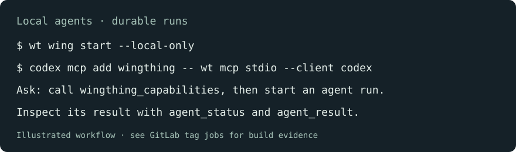

# wingthing

Wingthing is an open-source (MIT) agent manager. It runs coding agents such as
Claude Code and Codex in persistent terminal sessions on your own machines,
using the code and provider login already
there. You can detach and come back later from the `wt` command line or a
browser, and a parent agent can start and inspect the same sessions over MCP.

A **wing** is the runtime on an execution machine. It owns the processes,
terminal sessions, run records and local state there. A session is an interactive
terminal; a run is a supervised task with semantic status and a final result.
Workspaces and provider logins must already exist on that machine; Wingthing
does not synchronize them between wings.



[Source on GitLab](https://gitlab.com/ehrlich-b/wingthing) ·
[GitHub mirror](https://github.com/ehrlich-b/wingthing) ·
[GitHub issues](https://github.com/ehrlich-b/wingthing/issues) ·
[Build evidence](https://gitlab.com/ehrlich-b/wingthing/-/pipelines)
(successful tag jobs retain verification receipts; see the [release checklist](docs/release-verification.md)).

## Install

```bash
curl -fsSL https://wingthing.ai/install.sh | sh
```

The installer supports macOS and Linux on amd64 and arm64. It verifies the
release checksum, installs `wt` into `~/.local/bin` (set `WT_INSTALL_DIR` to
change that) and never runs sudo. Manual downloads are on
[GitHub releases](https://github.com/ehrlich-b/wingthing/releases). Update with
`wt update`. To build from source you need Go 1.26.9 or newer and Node.js:
`git clone https://gitlab.com/ehrlich-b/wingthing.git`, then `make check`.
The [download metadata](https://wingthing.ai/dl/latest.json) identifies the
available release and its assets. Source documentation can describe changes
that are not in that release; check `wt --version` and its release notes.

## First commands

Install and log in to an agent CLI first (`claude` or `codex`), then:

```bash
cd /path/to/existing/project
wt claude --name research   # start Claude in a persistent session and attach
# Ctrl+B then Q detaches; the session keeps running
wt                          # work list: every session, and which ones need a reply
wt attach research          # return to the same session
```

`wt claude` starts a local wing if none is running; no Wingthing account or
relay is involved. `wt codex --name review` starts a persistent Codex session.
See [daily work with wt](docs/daily-driver.md). The numbered sections below go
from the smallest setup to the largest; use the first one that fits.

## 1. Local agent control: stdio MCP

A parent agent can manage other agents on the same machine through typed MCP
tools. Start a local-only wing, then register the stdio server with the parent.
Keep the wing running. Use the same `WINGTHING_DIR` for the wing and the MCP
client process (default: `~/.wingthing`); if you customize it, configure that
environment in the parent client's MCP settings as well.

```bash
wt wing start --local-only
codex mcp add wingthing -- wt mcp stdio --client codex
claude mcp add --scope user wingthing -- wt mcp stdio --client claude
```

Restart the client and ask it to call `wingthing_capabilities`. It can then
start persistent agent terminals (`agent_start`), submit headless runs and read
their results without parsing terminal output (`agent_run`, `agent_result`), and
inspect the sandbox before a launch (`sandbox_explain`). `wt mcp stdio` needs a
wing that is already running. More: [MCP tasks](docs/mcp-tasks.md),
[Claude as a parent](docs/wt-claude.md), [recipe](patterns/local-subagents/INSTRUCTIONS.md).

## 2. Local human terminal: sandboxed agent

```bash
wt egg claude --name research          # agent in a sandboxed, persistent session
wt terminal --name api -- npm run dev  # any command, with the same persistence
wt attach research                     # reattach by name or ID
wt session ps --json                   # scriptable inventory; also read, send, wait
wt search 'DNS helper' --json          # search live and past sessions
```

The provider CLI must already be installed and logged in for the current OS
user. No Wingthing account is required. The first `wt egg` command can run on
its own. Native `wt attach` can attach to a standalone egg when the wing socket
is absent or refuses connection, no `WT_MCP_CLIENT` principal is named, and no
expected wing identity is pinned. Named clients and pinned wing identities
require the wing; wing-mediated attachment checks grants and session ownership.
An authorization denial or a lost attachment never triggers that fallback. More:
[session search](docs/session-search.md), [leave and return example](examples/leave-laptop/README.md).

## 3. Different machines: direct remote MCP

For a machine you already reach over SSH, `--remote` runs the same commands
there, and `wt mcp connect` gives a parent agent one inventory across this wing
and every remembered SSH wing:

```bash
wt --remote server.example.com                  # reattach or choose a session there
wt mcp connect add my-server --ssh my-server    # remember an already running wing
codex mcp add wingthing -- wt mcp connect --client codex
```

The remote host needs its own `wt`, provider CLI and provider login; Wingthing
copies none of them. The agent calls `wing_list` and passes a `wing_id` to every
wing-owned tool. To find wings through an account directory instead, first log
in and start Wingthing on every execution machine (`wt login`, then `wt start`)
and give the connector an explicit `--roost`. MCP payloads still travel directly
to the selected wing. It never silently falls back to the hosted relay. More:
[SSH remote sessions](docs/ssh-remote-sessions.md),
[remote orchestration recipe](patterns/remote-orchestration/INSTRUCTIONS.md).

## 4. Browser visibility: self-hosted roost

When a person needs a browser, run the browser portal locally first:

```bash
wt roost start --https
```

Then open `https://localhost:8443`. This needs no Wingthing account. `--https`
creates a localhost-only certificate authority and trusts it for the current
user; `wt local-cert remove` undoes that. A roost shared by several people needs
OAuth, public HTTPS and an exact enrollment list such as
`WT_ROOST_ALLOWED_EMAILS=alice@example.com,bob@example.com`. More:
[roost operation and local HTTPS](docs/fly-ops.md#local-https),
[shared roost recipe](patterns/shared-web-roost/INSTRUCTIONS.md).

## 5. Hosted browser relay: entitled and optional

`wingthing.ai` also runs a hosted browser relay at `app.wingthing.ai`. It applies
only when an account already has hosted-relay access and the wing allows it;
nothing above depends on it. A wing can refuse it with
`wt wing config set hosted_relay=deny`. See the
[hosted browser recipe](patterns/hosted-browser-wing/INSTRUCTIONS.md).

## Terms

A **wing** is one machine running Wingthing; it owns the sessions and run
records on that machine. An **egg** is one session's boundary: process,
terminal, sandbox policy and control socket. A **session** is a persistent
terminal you can detach from and reattach to. A **run** is a headless agent task
with status, events and a final result. A **roost** is a self-hosted browser
portal and gateway with a wing in the same process.

## Sandbox and supported agents

Each egg resolves an `egg.yaml` policy. By default the working directory is
writable, home is read-only, common credential directories are denied, the
environment is stripped, and the network is limited to the domains the selected
agent needs. macOS uses Seatbelt; Linux uses namespaces, seccomp and cgroups
when available. `wt egg explain claude --json` prints the resolved policy before
a launch. On Linux, `network: "*"` permits any TCP destination through HTTP
CONNECT but retains a route-less namespace. Clients must honor the proxy or
speak CONNECT; ordinary routed UDP, ICMP and raw sockets are unavailable.
Host-loopback TCP services need explicit `network.local_ports`. Limits are in
the [security model](docs/security.md#egg-sandbox).

Interactive sessions support Claude Code, Codex, Cursor Agent, Gemini CLI,
Hermes Agent, Ollama and OpenCode. `wt doctor` reports which are installed.
[Testing](docs/testing.md) records how far each has been verified.

## Documentation

- [Architecture and agent-manager contracts](docs/agent-manager-product-brief.md)
- [Security and sandbox policy](docs/security.md)
- [Self-hosted and Fly operations](docs/fly-ops.md)
- [Agent-facing skill](SKILL.md), [recipes](patterns/SKILL.md),
  [development guidance](CLAUDE.md), [current gaps](TODO.md)

## License

[MIT](LICENSE)
